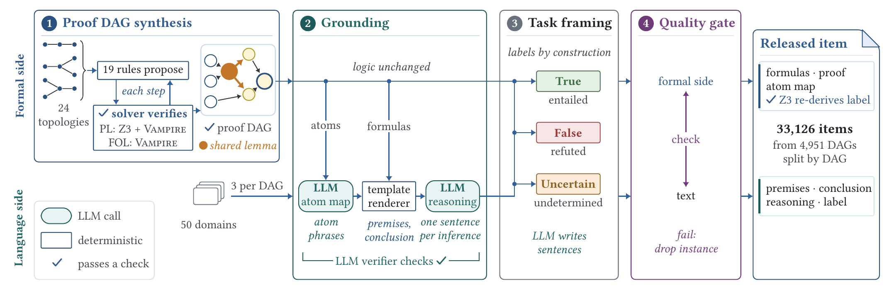

<h1 align="center">LogicDAG</h1>

<p align="center">
  <a href="article.pdf"><b>LogicDAG: Enhancing Logical Reasoning in LLMs via Solver-Verified Proof DAG Synthesis</b></a>
</p>

<p align="center">
  <a href="article.pdf"></a>
  <a href="#statistics"></a>
  <a href="#format"></a>
  <a href="LICENSE"></a>
</p>

<p align="center">
  <a href="article.pdf">Paper</a> ·
  <a href="#quick-start">Quick start</a> ·
  <a href="#dataset">Dataset</a> ·
  <a href="#construction">Construction</a> ·
  <a href="#citation">Citation</a>
</p>

<p align="center">
  
</p>

LogicDAG is a corpus of multi-step deductive reasoning items introduced in our [paper](article.pdf) for training large
language models and improving their logical reasoning.

Each item is grounded in a solver-verified proof DAG: a directed acyclic graph whose nodes are formulas of
propositional logic (PL) or first-order logic (FOL) and whose edges record the premises of each forward inference.
Because a derived formula can serve as a premise of several later inferences, proof DAGs capture lemma reuse that
sequential chains and proof trees do not. Every inference is verified by a solver, and every item is released with
its formal specification: the formula of each premise and of the conclusion, the symbolic
proof, and the mapping from symbols to natural language.

Each item presents a set of premises and a conclusion in English and asks whether the conclusion is **True**,
**False** or **Uncertain** given the premises. The target response is a step-by-step reasoning chain that follows the
symbolic proof.

## Highlights

- **Solver-verified steps.** Every forward inference is verified by a solver before a later inference may build on
  it: by Z3 and Vampire in propositional logic and by Vampire in first-order logic.
- **Proof DAGs with lemma reuse.** Proofs follow 24 topologies built from linear, fan-out and fan-in structures and
  their pairwise compositions, so a derived lemma can feed several downstream inferences.
- **Labels by construction.** The True, False and Uncertain labels follow from the formulas, and Z3 re-derives every
  label from the released formulas alone. The language model writes only the text.
- **Formal side with every item.** Each item carries its premise and conclusion formulas, its symbolic proof and its
  atom map.
- **Scale and coverage.** 33,126 items from 4,951 proof DAGs, with proof depths from 2 to 12, grounded in 50 domains.
- **Transfer.** Fine-tuning instruction-tuned Llama models on LogicDAG improves formal deduction in propositional
  logic and first-order logic on external benchmarks, and the gains extend to mathematics benchmarks
  ([paper](article.pdf)).

## Quick start

```bash
pip install pandas pyarrow
```

```python
import pandas as pd

train = pd.read_parquet("data/train.parquet")

row = train.iloc[0]
print(row["id"], row["label"])
for message in row["messages"]:
    print(f"[{message['role']}]\n{message['content']}\n")
```

With the Hugging Face Datasets library:

```python
from datasets import load_dataset

ds = load_dataset("parquet", data_files={
    "train": "data/train.parquet",
    "validation": "data/validation.parquet",
    "test": "data/test.parquet",
})
```

## Repository structure

```text
.
├── article.pdf                the paper
├── assets/                    figures used in this README
├── data/                      train, validation and test splits (Parquet)
├── domains.json               the pool of 50 domains
├── LICENSE
└── README.md
```

## Dataset

### Statistics

The dataset contains 33,126 items grounded in 4,951 proof DAGs, spanning 24 proof topologies and 50 domains
([`domains.json`](domains.json)).

| Split | Items | Proof DAGs | True | False | Uncertain |
| --- | ---: | ---: | ---: | ---: | ---: |
| train | 31,495 | 4,705 | 13,431 | 13,404 | 4,660 |
| validation | 785 | 122 | 340 | 334 | 111 |
| test | 846 | 124 | 354 | 362 | 130 |
| **total** | **33,126** | **4,951** | **14,125** | **14,100** | **4,901** |

The splits are disjoint at the level of proof DAGs: all items grounded in one DAG belong to the same split.

### Format

Each row is one item in chat format.

| Field | Type | Description |
| --- | --- | --- |
| `id` | string | Item identifier. Its prefix `dag_ID` identifies the proof DAG in which the item is grounded. |
| `messages` | list of `{role, content}` | Three turns: the system prompt, the user prompt with the task instructions, the numbered premises and the conclusion, and the assistant response with the numbered reasoning chain, a `Final verdict:` line and the answer in `\boxed{}`. |
| `label` | string | `True`, `False` or `Uncertain`. |
| `premises_fol` | list of string | Formula of each premise, in the order in which the premises appear in the prompt. |
| `conclusion_fol` | string | Formula of the conclusion. |
| `proof` | list of `{step, rule, premises, conclusion}` | Symbolic proof from the premises, one forward inference per step, with the rule name, the formulas it uses (premises or earlier conclusions) and the formula it concludes. For a True item the final step derives the conclusion, and for a False item it derives a formula that contradicts the conclusion. For an Uncertain item, neither the conclusion nor its negation is entailed by the premises. |
| `atom_map` | list of `{symbol, text}` | Natural-language text of each atomic formula. An entry whose symbol starts with `¬` gives the text of the atom's negation. |

### Example

<details>
<summary><code>dag_02972_i1_true</code> (train, label True): a fan-out proof DAG with a shared lemma</summary>

```text
[user]
Decide whether the conclusion is:
- True: it follows from the premises.
- False: it is contradicted or ruled out by what follows from the premises.
- Uncertain: the premises do not provide enough information to determine it.

Use only the premises. Give thorough step-by-step reasoning, citing which premises support each inference step. Then put your final answer in \boxed{} as exactly one of: True, False, or Uncertain.

Premises:
1. The server receives the backup command
2. If the server receives the backup command, then the backup job completes successfully
3. If the backup job completes successfully, then the database snapshot is created
4. If the backup job completes successfully, then the integrity check passes

Conclusion:
The database snapshot is created and the integrity check passes

[assistant]
Reasoning:
1. Since the server receives the backup command, and the stated rule indicates that receiving this command leads to a successful backup job, it follows that the backup job completes successfully.
2. Given that the backup job completes successfully, and the rule linking this completion to the creation of a database snapshot, we conclude that the database snapshot is created.
3. Since the backup job completes successfully, and the rule linking this completion to a passing integrity check, it follows that the integrity check passes.
4. Combining the established fact that the database snapshot is created with the fact that the integrity check passes, we conclude that the database snapshot is created and the integrity check passes.

Final verdict: True
Final answer: \boxed{True}
```

```json
{
  "premises_fol": ["P954", "P954→A791", "A791→A794", "A791→A795"],
  "conclusion_fol": "A794∧A795",
  "proof": [
    {"step": 1, "rule": "modus_ponens", "premises": ["P954", "P954→A791"], "conclusion": "A791"},
    {"step": 2, "rule": "modus_ponens", "premises": ["A791", "A791→A794"], "conclusion": "A794"},
    {"step": 3, "rule": "modus_ponens", "premises": ["A791", "A791→A795"], "conclusion": "A795"},
    {"step": 4, "rule": "conj_intro", "premises": ["A794", "A795"], "conclusion": "A794∧A795"}
  ],
  "atom_map": [
    {"symbol": "A791", "text": "The backup job completes successfully."},
    {"symbol": "A794", "text": "The database snapshot is created."},
    {"symbol": "A795", "text": "The integrity check passes."},
    {"symbol": "P954", "text": "The server receives the backup command."},
    {"symbol": "¬A791", "text": "The backup job does not complete successfully."},
    {"symbol": "¬A794", "text": "The database snapshot is not created."},
    {"symbol": "¬A795", "text": "The integrity check does not pass."},
    {"symbol": "¬P954", "text": "The server does not receive the backup command."}
  ]
}
```

Step 1 derives the shared lemma `A791` (the backup job completes successfully), and steps 2 and 3 both use it.
Step 4 joins their conclusions into the target `A794∧A795`, so the label is True. The same instance also yields a
False item and an Uncertain item with the same four premises and four proof steps.

</details>

## Construction

The data is produced by a five-step pipeline in which logical validity is decided exclusively by automated theorem
provers on the symbolic proof, while a language model writes the surface realization.

**1. Symbolic proof DAG synthesis.** Proof structures are drawn from a library of 24 PL and FOL topologies, including
linear, fan-out and fan-in structures and their pairwise compositions. Fan-out structures reuse a derived lemma across
several downstream branches by construction. For each topology, a topology constructor builds a target formula and a
seed set of axioms such that a designated inference sequence is the natural forward proof. Seed sets are checked for
satisfiability. Forward saturation then applies 19 forward inference rules breadth-first from the seeds, and canonical
hashing merges conclusions reached along different paths into a single node, which yields shared sub-derivations.
Every forward inference is gated by a solver before it enters the proof state: PL inferences by both Z3 and Vampire,
FOL inferences by Vampire. A traceback from the target extracts its proof sub-DAG, and the axioms are verified to
entail the target. The resulting proofs have depths between 2 and 12.

**2. Natural language grounding.** Each DAG is instantiated in three distinct domains drawn from a pool of 50.
[Qwen3.8-27B](https://huggingface.co/Qwen/Qwen3.8-27B) maps every atom to a natural-language statement in the domain
(atom mapping), a recursive template renderer verbalizes every formula, and the model rewrites the rule-labeled proof
scaffold into a reasoning chain with one sentence per inference step (proof trace generation). A second call to the same
model checks each instance against its symbolic ground truth: the consistency of the atom mapping, the faithfulness of
every inference step and the correctness of the conclusion. Of the 15,000 instances, 13,867 (92.4%) are admitted.

**3. Task framing.** Each admitted instance yields labeled items built on its premises and its proof. The True item
states the DAG's target. The False item states the target's negation and extends the reasoning chain with a refutation
step. Uncertain items state a conclusion that the premises leave underdetermined, such as one disjunct of a disjunctive
target, the converse of a conditional target, the universal counterpart of an existential target, or a statement the
premises do not mention. Their reasoning chain ends with a step that identifies the gap. Some items add one premise that
links a statement not mentioned in the DAG to a statement the proof settles, and ask about the new statement. Labels
follow from the construction.

**4. Quality gate.** An instance is released only if all of its items pass four groups of checks.

- *Structure*: the items are well-formed, and each reasoning chain has the length its proof requires.
- *Rendering*: no two atoms share a text, and the text is checked for malformed negations and for formula symbols
  left in the reasoning chain.
- *Reasoning*: conditional statements in a reasoning chain are checked against the proof, and False and Uncertain
  reasoning chains are checked for statements that the conclusion follows.
- *Arithmetic*: statements about integers and weekdays that fit a fixed grammar are checked against arithmetic by Z3
  and direct search.

The gate removes 199 of the 13,867 instances.

**5. Splits.** Items are partitioned into training, validation and test splits by proof DAG.

## Prerequisites

The dataset was built with the following components:

- **Language model:** [Qwen3.8-27B](https://huggingface.co/Qwen/Qwen3.8-27B), served with [vLLM](https://github.com/vllm-project/vllm)
- **SMT solver:** [Z3](https://github.com/Z3Prover/z3) 5.1.0
- **Theorem prover:** [Vampire](https://vprover.github.io/) 5.1.0

## Citation

If you use LogicDAG, please cite the paper:

```bibtex
@misc{ho2026logicdag,
  author = {Duc-Hieu Ho and Son N. Tran and Cuong Vo and Phuc-Tinh Pham Do and Tran Van Nhiem and Ngoc-Thanh Dinh and Thin Nguyen and Thanh-Toan Do and Trung Le},
  title = {{LogicDAG: Enhancing Logical Reasoning in LLMs via Solver-Verified Proof DAG Synthesis}},
  howpublished = {Preprint
                  \href{https://github.com/LogicDAG/LogicDAG/blob/main/article.pdf}{github.com/LogicDAG/LogicDAG}},
  year = {2026}
}
```

## Acknowledgements

The natural-language text of LogicDAG was generated with [Qwen3.8-27B](https://huggingface.co/Qwen/Qwen3.8-27B),
developed by the Qwen Team:

```bibtex
@misc{qwen38,
    title = {{Qwen3.8-Max}: A New Bar for Coding and Cowork},
    url = {https://qwen.ai/blog?id=qwen3.8},
    author = {{Qwen Team}},
    month = {August},
    year = {2026}
}
```

## License

The dataset is released under the [MIT License](LICENSE). [Qwen3.8-27B](https://huggingface.co/Qwen/Qwen3.8-27B), the model used to generate the
natural-language text, is under the Apache-2.0 License.
